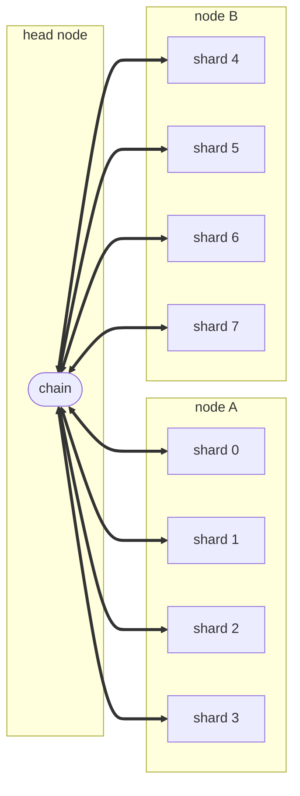
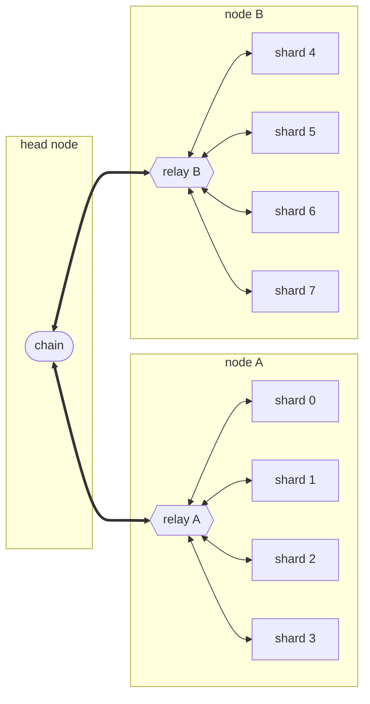
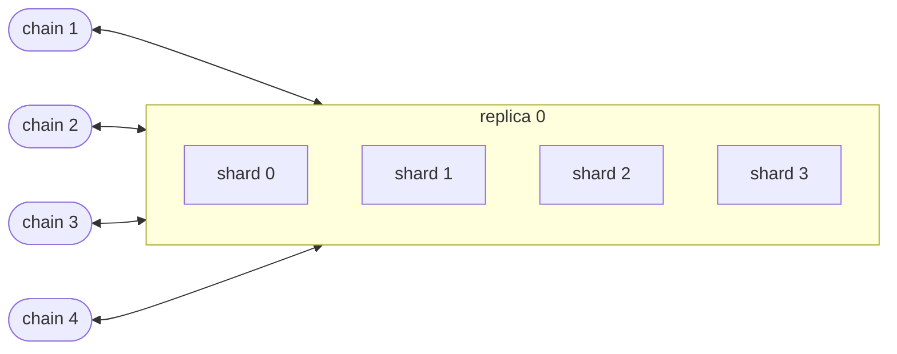
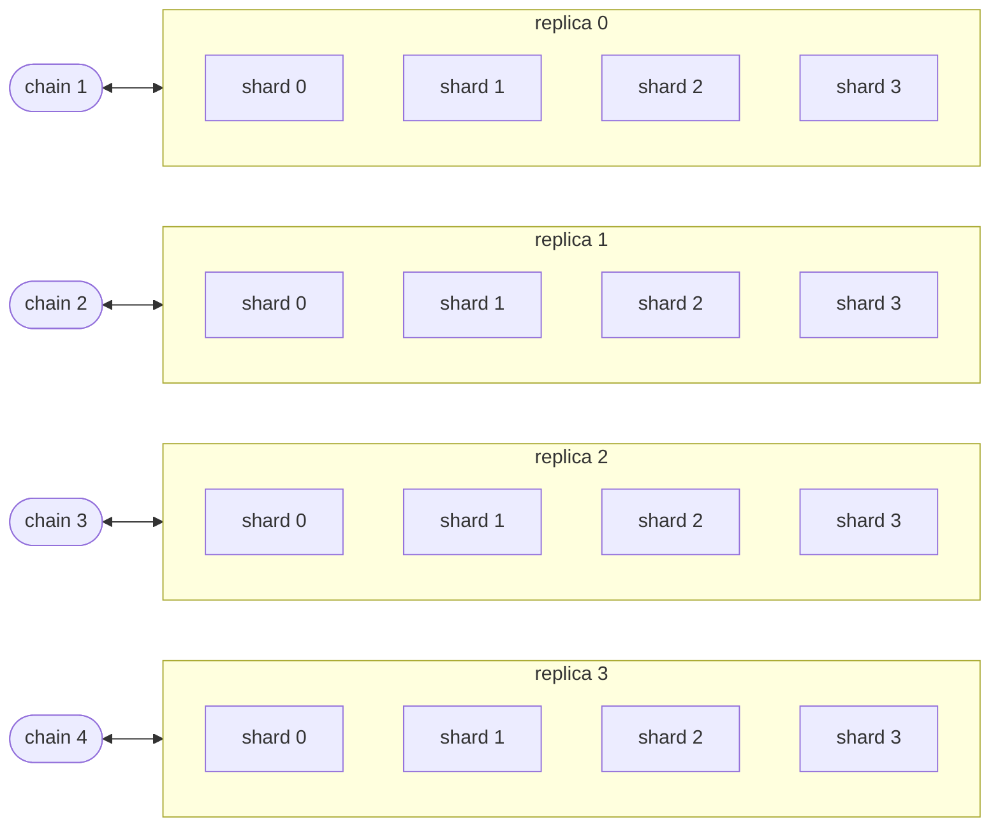

# pymc-ray

Utilities for scaling [PyMC](https://www.pymc.io) models to large datasets with [Ray](https://www.ray.io).

| Situation | Tool | Posterior |
|---|---|---|
| Data split by a key, and you want one independent model per group | `fit_grouped` | Exact, per group |
| One model whose likelihood needs *all* the data, and the data are too large for one process or machine | `ShardedModel` | Exact |
| Same, but you can accept an approximation in exchange for zero communication, and the model has no group-level (multilevel) structure | `consensus_sample` | Approximate |

Requires PyMC ≥ 6.3 (Python ≥ 3.12) and Ray ≥ 2.40. Posteriors are returned as `xarray.DataTree`, as `pm.sample` returns them.

## Installation

```bash
conda env create -f environment.yml # Python 3.13 + editable install with dev extras
conda activate pymc-ray
# or, in an existing environment:
pip install -e ".[dev]"
```

## Data: bring your own dataframe library

Data handling goes through [narwhals](https://narwhals-dev.github.io/narwhals/), so you are not tied to pandas. Every function accepts:

- **An eager dataframe from any library narwhals supports**: pandas, polars, pyarrow, modin, cuDF and others. Your `model_fn` receives row subsets **of the same type**: pass polars in, get polars shards or groups back.

- **A `ray.data.Dataset`** for data larger than the driver's memory, e.g. `ray.data.read_parquet(...)`. Each worker loads only its own rows, as Arrow, and converts them to the library named by `backend=` (`"pandas"` by default; also `"polars"`, `"pyarrow"`, ...).

- **A dict of equal-length arrays** (`ShardedModel` and `consensus_sample` only).

Lazy frames (polars `LazyFrame`, DuckDB, ...) are rejected rather than silently collected onto the driver: collect them yourself, or read the data as a Ray Dataset.

To write one `model_fn` that works with any of these libraries, read columns through narwhals:

```python
import narwhals.stable.v2 as nw


def model_fn(data):
    frame = nw.from_native(data, eager_only=True)
    X = frame.select("x0", "x1").to_numpy()
    y = frame["y"].to_numpy()
    with pm.Model() as model:
        ...
    return model
```

## 1. Many groups: `fit_grouped`

Write a function that builds the model for **one** group's data. `fit_grouped` fits all groups in parallel, one Ray task per group.

```python
import pymc as pm
import pymc_ray as pmr


def model_fn(df): # receives one group's rows
    with pm.Model() as model:
        alpha = pm.Normal("alpha", 5, 2)
        elasticity = pm.Normal("elasticity", -1, 1)
        sigma = pm.HalfNormal("sigma", 1)
        mu = alpha + elasticity * df["log_price"].to_numpy()
        pm.Normal("log_units", mu, sigma, observed=df["log_units"].to_numpy())
    return model


results = pmr.fit_grouped(
    sales_df,
    "store",
    model_fn,
    fit_kwargs={"draws": 1000, "chains": 4},
    random_seed=42,
)
results["store_007"] # DataTree for one store
results.summary(var_names=["elasticity"]) # one table, indexed by (store, variable)
results.failures # groups that raised, with worker tracebacks
```

- **Input.** Any eager dataframe, or a `ray.data.Dataset`. A Dataset is grouped and fitted on the cluster with `map_groups`, so the data never pass through the driver. Null group keys are reported as `None` whichever library produced them.

- **Parallelism.** By default each group runs its chains sequentially (`cores=1`) on one CPU, and parallelism comes from fitting many groups at once. Pass `fit_kwargs={"cores": 4}` to give each group 4 CPUs instead.

- **Memory.** `postprocess_fn(key, model, result, random_seed)` runs on the worker before results are returned. Return a summary, or write the posterior to storage and return its path, so that 100k groups do not have to fit in driver memory (see [examples/grouped_models.py](examples/grouped_models.py)).

- **Reproducibility.** Each group's seeds are derived from `random_seed` and the group key, so a group gets the same draws however the work is scheduled, and whichever other groups are in the run. `postprocess_fn` receives its own seed, separate from the one used for fitting, for any random work it does.

- **Errors.** `on_error="raise"` (default; cancels pending groups), `"warn"` or `"ignore"`.

- **Other fitters.** `fit_fn` is called as `fit_fn(model=model, random_seed=seed, **fit_kwargs)`, so `pm.fit` or a wrapper around nutpie or `pm.find_MAP` also work.

- **Posterior predictive checks.** Each worker holds its group's model, so add them in `postprocess_fn`:

  ```python
  def with_ppc(key, model, idata, random_seed):
      return pm.sample_posterior_predictive(
          idata, model=model, extend_inferencedata=True, random_seed=random_seed
      )


  results = pmr.fit_grouped(sales_df, "store", model_fn, postprocess_fn=with_ppc, random_seed=42)
  ```

## 2. One model, too much data

Both tools take the same `model_fn(data) -> pm.Model` and any of the data containers above. They split the rows into shards and call `model_fn` on each shard.

The model's free random variables (names and shapes) must not depend on which rows `model_fn` receives. **Build coords from global metadata**, not from the data.

```python
STORES = np.array(sorted(all_store_ids)) # global, known up front


def model_fn(data):
    stores = nw.from_native(data, eager_only=True)["store"].to_numpy()
    idx = np.searchsorted(STORES, stores) # good: positions in the global list
    # coords={"store": np.unique(stores)} # bad: differs between shards
    with pm.Model(coords={"store": STORES}) as model:
        ...
```

`ShardedModel` checks this and raises an error naming the offending variables.

### Exact: `ShardedModel`

```python
data = ray.data.read_parquet("s3://bucket/events/") # each actor loads only its shard

with pmr.ShardedModel(model_fn, data, n_shards=32, shard_by="group") as sharded:
    print(sharded.benchmark(chains=4)) # seconds per logp+gradient evaluation
    idata = sharded.sample(draws=1000, chains=4)
```

**How it works.** Each shard is held by a Ray actor that compiles the log-likelihood and its gradient for its rows. On the driver, `model_fn` is called with zero rows (leaving only the priors), and a `Potential` is added whose value is a PyTensor `Op` that sends the current parameters to every actor and sums what they return. NUTS therefore targets the exact full-data posterior. Each leapfrog step costs one round trip to the actors, and only the parameters and gradients travel over the network. The logp and gradient match the full-data model.

- **Samplers.** `sharded.model` is an ordinary `pm.Model`, and `sharded.sample(**kwargs)` passes everything on to `pm.sample`.

  - With PyMC's own NUTS (`nuts_sampler="pymc"`), chain processes are started with `mp_ctx="spawn"` because a Ray connection does not survive `fork()`, so forked chain processes would deadlock. pymc-ray raises an error instead of hanging if you try.

  - **nutpie** also works (`nuts_sampler="nutpie"`, with its default Numba backend), and PyMC uses it by default whenever it is installed. Its chains are threads in one process, so there are no chain processes to spawn, and each thread leases its own replica.

  - **Ray Client** (a `ray://` address, e.g. a notebook on your laptop): `sharded.sample()` and `sharded.benchmark()` run in a Ray task on the node where the session's driver runs on the cluster (normally the head node), and only the result comes back. The progress bar is off by default there, because it would print on the cluster.

- **Data-dependent Potentials** (e.g. a custom likelihood written as `pm.Potential`) must be listed in `likelihood_potentials=[...]` so they are summed over shards. Other Potentials are treated as part of the prior.

- **Missing-value imputation** is not supported: it creates free variables that depend on the rows.

- **Placement and communication options** (`shard_by`, `n_replicas`, `relays`, `actor_options`) are explained in [Performance](#performance-when-sharding-pays-off).

### Approximate: `consensus_sample`

```python
idata = pmr.consensus_sample(
    model_fn,
    data,
    n_shards=16,
    sample_kwargs={"draws": 1000, "chains": 4},
)
```

**How it works.** Consensus Monte Carlo ([Scott et al., 2016](https://doi.org/10.1080/17509653.2016.1142191)). Shard *s* is sampled independently on its own worker from the subposterior $p(\theta)^{(1/S)} \cdot p(shard_{s} | \theta)$, with no communication during sampling. The product of the subposteriors is the full posterior. The draws are combined on the unconstrained scale (as precision-weighted averages, or as a product of Gaussian approximations with `method="gaussian"`) and then transformed back, so constraints such as positivity are respected. The combination is exact when every subposterior is Gaussian.

It works well when each shard has enough data for its subposterior to be close to Gaussian, in cases like regression-type models with many rows per parameter. It breaks down for multilevel models, multimodal posteriors and discrete parameters. Check the per-shard posteriors with `return_subposteriors=True`. Only free variables are combined, so you need to recompute deterministics with `pm.compute_deterministics`. It samples with PyMC's own NUTS by default, because the combination needs the unconstrained draws, which nutpie does not return.

### Exact vs approximate, at a glance

| | `ShardedModel` | `consensus_sample` |
|---|---|---|
| Posterior | Exact | Approximate (exact for Gaussian subposteriors) |
| Communication | One round trip per leapfrog step | None during sampling |
| Sensitivity to network latency | High | None |
| Multilevel models | Exact | Biased: do not use |
| Multimodal posteriors | Exact (as far as NUTS mixes) | Unreliable |
| Scaling to many nodes | Bounded by round-trip latency | Embarrassingly parallel |

### Multilevel models

Multilevel models are where sampling gets slow, here are some helpers when fitting such models.

- **`ShardedModel` is exact for them.** A group's rows may span any number of shards.

- **Pass `shard_by="<group column>"` when there are many groups.** Every group then lives on a single shard, so each shard's gradient is zero for every other group's
  parameters, and only the nonzero entries travel back over the network. With thousands of groups this shrinks the per-step messages considerably. Results are identical either way.

- **Do not use `consensus_sample` for them.** Tempering the prior of the group-level parameters lets each shard absorb group variation into the local parameters, so every
  shard, and therefore the combination, underestimates the group-level standard deviations by roughly $\frac{1}{\sqrt(n\_shards)}$.

- **Mind the parameterization.** NUTS makes one round trip per leapfrog step, so a model that needs fewer steps per draw samples proportionally faster. When groups have plenty of data each, the centered parameterization usually needs far fewer steps than the non-centered one.

## 3. Posterior predictive checks and LOO

The observed data live on the shards, so in-sample checks run there too. Each shard handles its own rows, and the results come back in the order of your data.

```python
with pmr.ShardedModel(model_fn, data, n_shards=32, shard_by="group") as sharded:
    idata = sharded.sample(chains=4)
    ppc = sharded.sample_posterior_predictive(idata, num_draws=200, random_seed=1)
    elpd = sharded.loo(idata) # equals arviz.loo on the full data
    idata = sharded.compute_log_likelihood(idata) # the full pointwise arrays, if they fit

az.compare({"this model": elpd, "another model": other_elpd})
```

- **`sample_posterior_predictive`** returns `posterior_predictive` and `observed_data` groups, like `pm.sample_posterior_predictive`. The result holds chains × draws × rows values per variable. Thin it with `num_draws` (evenly spaced draws per chain). If even that will not fit in memory, pass `postprocess_fn(shard, model, result)` where it runs where each shard lives, can write that shard's draws to storage, and its return values (the paths) come back instead.

  ```python
  def save(shard, model, result):
      path = f"{output_dir}/ppc-shard-{shard}.nc" # storage that every node can reach
      result.to_netcdf(path)
      return path


  paths = sharded.sample_posterior_predictive(idata, postprocess_fn=save)
  ```

- **`loo`** computes the pointwise log-likelihood and PSIS-LOO on each shard and sends back only one value per row. It therefore works even when the full log-likelihood (chains × draws × rows values) would not fit anywhere. The result is ArviZ's own LOO object, and it prints as `arviz.loo` does, flags high Pareto k values, and works with `arviz.compare`.

- **`compute_log_likelihood`** returns the full pointwise arrays, for use with ArviZ directly when they fit.

- **Predictions on new data** that fit in memory don't sharding, `pm.sample_posterior_predictive(idata, model=model_fn(new_data))`. Sharded posteriors omit deterministics that depend on the data, because the driver computes them on zero rows. To recompute one on the data, pass it in `var_names`.

- **Posteriors from anywhere else**, such as `consensus_sample` or a saved posterior, `pmr.sample_posterior_predictive(idata, model_fn, data, n_shards=...)`, `pmr.compute_log_likelihood(...)` and `pmr.loo(...)` run the same computations on short-lived Ray tasks.

- **Row order** is that of the input data, with or without `shard_by`. The exception is a Ray Dataset split with `shard_by`, whose original order is not known. Give the observations a dim whose coords come from an id column, so every value carries its label, or use `postprocess_fn`.

## Performance: when sharding pays off

How much `ShardedModel` helps depends on your model, your data and your hardware. On small data it is slower than plain PyMC, and on large data it can be several times faster. Measure on your own setup (see [Measuring on your own hardware](#measuring-on-your-own-hardware)). The model below explains what you will see.

### What a step costs

NUTS evaluates the log-density and its gradient once per leapfrog step, and multilevel posteriors often need tens to hundreds of steps per draw. With sharding, each step is
roughly

```
step time ≈ slowest shard's compute × (chains queued on each shard)
          + one round trip to the shards (latency + transfer of parameters and gradients)
          + a small overhead for every shard the chain contacts
```

Plain PyMC pays only the compute, all of it, on one core per chain. Sharding wins when splitting the compute saves more than the communication adds.

### Rules of thumb

- **Small data: stay in-process.** If one full-data evaluation is fast, the round trip to the actors costs more than it saves.

- **One large machine: sharding puts idle cores to work.** Each chain normally uses one core, shards let a chain use many. The gains level off once the shards saturate the machine's memory bandwidth, and they are smaller when several chains already keep several cores busy. Machines with many cores per chain benefit most.

- **Several machines: only on a low-latency network.** Every leapfrog step waits for a round trip to every machine that holds shards. Within a data center or rack that costs little. Between distant machines it can exceed the compute it saves, and then one large machine can be faster than several far-apart ones. To keep every shard on one node.

  ```python
  from ray.util.scheduling_strategies import NodeAffinitySchedulingStrategy

  here = NodeAffinitySchedulingStrategy(ray.get_runtime_context().get_node_id(), soft=False)
  sharded = pmr.ShardedModel(model_fn, data, n_shards=32, actor_options={"scheduling_strategy": here})
  ```

- **Many parameters: shard by group.** Every step sends the full parameter vector out and a gradient of the same size back. For multilevel models with thousands of groups, use `shard_by="<group column>"` so the gradients come back sparse.

- **More shards is not always faster.** Each shard a chain contacts adds per-step overhead, and past some point that outweighs the smaller shards. The sweet spot depends on the hardware, find it with `cluster_scaling.py` or `sharded.benchmark()`.

- **Fewer gradient evaluations mean fewer round trips.** A sampler that adapts well and a well-parameterized model help sharded sampling directly.

- **Memory is a reason on its own.** When PyMC's multiprocess sampler starts chains with `spawn` or `forkserver`, it copies the data into every chain process. `ShardedModel` keeps one copy, spread across the actors (one per replica), so it also helps when the data barely fit in memory.

### Options that change the communication

- **`shard_by=`** keeps each group's rows on one shard, so gradients come back as their nonzero entries only.

- **Relays** are on automatically when the shards span several nodes (`relays=` to override). Each chain sends one message per node per step. Each node's relay forwards it to its local shards and adds their gradients up before replying, so the traffic crossing the network no longer grows with the number of shards.

- **`n_replicas=`** makes that many copies of every shard actor. Each chain process (or thread) leases one replica and only ever talks to that replica's actors, so concurrent chains do not queue on the same actors. It helps when queueing or fan-out is the bottleneck and there is spare hardware. It costs `n_replicas` copies of the data in actor memory, and gains little when the hardware itself is already saturated.

- **`actor_options=`** passes Ray options to every shard actor. By default actors are spread across nodes (`scheduling_strategy="SPREAD"`); pin them to one node as shown above. `sharded.placement()` reports how many actors landed on each node.

- **`env_vars=`** sets two Ray settings in every process `ShardedModel` starts (shard actors, relays, PyMC's chain processes, and the sampling task through Ray Client). `RAY_get_check_signal_interval_milliseconds="10"` stops `ray.get` from sometimes waiting a full second for results that are already available, which on some clusters stalls most steps. `RAY_max_direct_call_object_size="8388608"` sends parameters and gradients of up to 8 MiB inside each call instead of through the object store, saving round trips between nodes on every step. Both are on by default and take precedence over the same variables in your job's `runtime_env`. Pass your own dict to replace them, or `env_vars={}` for Ray's defaults. They cannot reach a process that is already connected: when chains run in your own process without Ray Client (nutpie's threads, or `cores=1`), set them in its environment before `ray.init`.

#### Example: relays

Two worker nodes hold four shards each, and one chain samples from the head node. The model has 10,000 parameters, so the parameter vector and each gradient are 80 KB. Each
arrow below is one round trip per leapfrog step, the parameters go out and a gradient comes back. Thick arrows cross the network and thin ones stay inside a node.

Without relays, the chain makes 8 round trips over the network every step (640 KB out, 640 KB back) and adds up 8 gradients itself.



With relays, it makes 2 round trips, one per node (160 KB each way). Each relay passes the parameters to the shards on its own node, adds up their gradients and replies once.



The shards compute the same thing and the result is identical, only the routing changes. Relays do not shorten the shards' compute. When the shards sit on the chain's own node there is no network to save and a relay only adds a hop, which is why relays are on by default only when the shards span several nodes. Pass `relays=True` if all the shards sit on one node that is not the chain's.

#### Example: replicas

Four chains sample on one machine. One evaluation over all the data takes 80 ms on one CPU, and a shard actor serves one request at a time. An arrow into a replica below means the chain sends every step's request to each shard in it.

With 4 shards and 1 replica (4 CPUs), a request takes 20 ms, but all four chains send to the same four actors. Each actor works through the chains' requests one after another, so each chain gets a reply about every 80 ms.



With 4 shards and 4 replicas (16 CPUs), each chain leases its own copy of the four shards, round-robin. Nobody waits, and a step takes about 20 ms, at the cost of four copies of the data in memory:



The fair comparison spends the same 16 CPUs on more shards instead (layouts are SHARDSxREPLICAS):

| layout | CPUs | step (compute) | actors a chain contacts per step | copies of the data |
|---|---|---|---|---|
| `4x1` | 4 | ~80 ms | 4 | 1 |
| `4x4` | 16 | ~20 ms | 4 | 4 |
| `16x1` | 16 | ~20 ms (5 ms × 4 chains) | 16 | 1 |

On the same hardware the compute comes out the same, replicas only cut how many actors each chain contacts per step. They pay off when more shards stop helping because of that per-actor overhead (say `16x4` instead of `64x1` on 64 CPUs), and only if there is memory for the extra data copies.

## Measuring on your own hardware

Three scripts in [benchmarks/](benchmarks) answer the practical questions. All of them time one joint logp+gradient evaluation (one leapfrog step), and `--chains N` makes N
processes evaluate concurrently, as chains do while sampling. `ray_overhead.py` and `cluster_scaling.py` join a running cluster (`--address`, default `auto`) `gradient_eval.py` starts a local Ray instance on the machine it runs on.

1. **What does communication cost here?** `ray_overhead.py` times round trips to trivial actors, with no PyMC involved, from the driver to actors spread over all nodes, and from an actor to actors on its own node. A large jump as soon as actors span nodes means cross-node latency will dominate. Shard within one node in that case.

2. **Does sharding beat plain PyMC on one machine?** `gradient_eval.py` compares plain PyMC (`pmr.time_logp_dlogp(model, chains=4)`) with `ShardedModel` layouts written as SHARDSxREPLICAS, for a logistic or a multilevel model at the sizes you choose. To time your own model, call `pmr.time_logp_dlogp(your_model, chains=4)` and `sharded.benchmark(chains=4)` directly.

3. **Does it beat plain PyMC on a cluster?** `cluster_scaling.py` runs plain PyMC as a Ray task pinned to one node, so both sides get the same hardware, then times each layout. It also reports the shards' own compute time per call. If a step takes much longer than (chains ÷ replicas) × that compute, the rest is communication. In that case try `--shard-by`, fewer shards, or `--single-node`.

Submit the cluster scripts as Ray jobs. The `pip` runtime environment installs PyMC into an isolated environment on every node, leaving the cluster's own Python untouched.

```bash
ray job submit --address http://<head-node>:8265 --working-dir benchmarks \
    --runtime-env-json '{"pip": ["pymc>=6.3", "narwhals>=2", "polars"], "py_modules": ["src/pymc_ray"]}' \
    -- python cluster_scaling.py --rows 5000000 --shard-by group
```

`--working-dir benchmarks` uploads only that folder, which also sidesteps a crash in older Ray versions on unusual `.gitignore` files elsewhere in the tree.

Useful flags:
`--groups`, `--layouts 16x1 32x1 8x4` (default `auto`, derived from the cluster's size), `--single-node`, `--relays {auto,on,off}`, and `--sample` for a short end-to-end `pm.sample` comparison. If the cluster autoscales, give it a fixed number of nodes before measuring because actors created while nodes are still starting all land on the first available node.

## Model functions on a cluster

Model functions are pickled to the workers. Lambdas and closures defined in your script work as they are. Functions imported from your own modules must be importable on the
workers: use `ray.init(runtime_env={"working_dir": "."})` or `py_modules=[...]`.

## Infrastructure: a Ray cluster on Azure

[infrastructure/azure-config.yaml](infrastructure/azure-config.yaml) describes a three-node cluster in `eastus2`: one head node and two workers, all `Standard_F16as_v6` (16 vCPUs, one physical core per vCPU). Every node gets Python 3.13, Ray 2.59.0, PyMC 6.3.2, PyTensor 3.3.4, and this repo installed with its `test` extras, which include nutpie. The head gives Ray 12 of its 16 cores and keeps 4 free for the chains, which run on the head, so Ray sees 44 CPUs in total.

The VMs are billed for as long as they exist, so bring the cluster down when you are done. Run every command below from the repo root.

### Prerequisites

- **The Azure CLI**, signed in to the subscription that will pay for the cluster. Ray uses the CLI's login.

  ```bash
  az login
  az account show --query "{name: name, id: id}" -o table # check that this is the right subscription
  ```

- **vCPU quota** for 48 vCPUs of the Fasv6 family in `eastus2` (3 nodes × 16 vCPUs), and for 48 regional vCPUs in total. New subscriptions often have less. Request an increase under *Quotas* in the Azure portal if needed.

  ```bash
  az vm list-usage --location eastus2 -o table | grep -iE "fasv6|total regional"
  ```

- **The Azure SDK packages that Ray's launcher uses**, in the `pymc-ray` environment. These are the same versions the head node installs:

  ```bash
  conda activate pymc-ray
  pip install azure-core==1.35.0 azure-identity==1.23.1 azure-mgmt-compute==35.0.0 azure-mgmt-network==29.0.0 azure-mgmt-resource==24.0.0 azure-common==1.1.28 msrest==0.7.1 msrestazure==0.6.4.post1
  ```

- **Ray 2.59.0 and Python 3.13 on your machine.** Ray Client refuses to connect when the Ray version or the Python minor version differs from the cluster's. Check with `ray --version`, and run `pip install "ray[default]==2.59.0"` if it shows another version.

- **`envsubst`**, which comes with gettext (`brew install gettext` on macOS).

### Bring the cluster up

The config holds the subscription id as `${AZURE_SUBSCRIPTION_ID}`, which Ray does not expand. Render the id into a copy of the config first. The rendered copy is git-ignored, and every later command uses it.

```bash
export AZURE_SUBSCRIPTION_ID=$(az account show --query id -o tsv)
envsubst '$AZURE_SUBSCRIPTION_ID' < infrastructure/azure-config.yaml > infrastructure/azure-config.rendered.yaml
ray up -y infrastructure/azure-config.rendered.yaml
```

`ray up` creates the resource group `ray-cluster-rg`, with a virtual network, a network security group that lets in SSH only, and a managed identity. It then starts the head node, copies this repo to it, and installs everything, which takes several minutes. Then the head launches the two workers itself, which takes a few more minutes. Wait for both workers before you create a `ShardedModel`, because actors created while workers are still starting all land on the head:

```bash
ray exec infrastructure/azure-config.rendered.yaml "ray status" # repeat until 2 ray.worker.default nodes are active
```

After you change the code locally, rerun `ray up` with the same config to copy it to the cluster again.

### Connect with Ray Client (port 10001)

The network security group lets in SSH only, so you reach the head node's Ray Client server (port 10001) through an SSH tunnel. `ray attach` opens a shell on the head node and forwards the port for as long as that shell stays open:

```bash
ray attach infrastructure/azure-config.rendered.yaml -p 10001
```

Leave that terminal open. In another terminal, point Ray at the tunnel, then start Python or Jupyter from that shell:

```bash
export RAY_ADDRESS=ray://localhost:10001
```

`ray.init()` reads `RAY_ADDRESS`, and the example notebooks do too. Code sent through Ray Client runs on the cluster's Python, so pass a `runtime_env` for anything it is missing, as [examples/sharded_tutorial.ipynb](examples/sharded_tutorial.ipynb) does.

### Open the Ray dashboard

```bash
ray dashboard infrastructure/azure-config.rendered.yaml
```

This forwards the head node's dashboard (port 8265) to http://localhost:8265 until you stop it with Ctrl-C. If local port 8265 is already in use, for example by a tunnel to another cluster, pick another local port with `--port 8266` and open http://localhost:8266. The same address is the one to pass to `ray job submit --address` (see [Measuring on your own hardware](#measuring-on-your-own-hardware)).

To forward both ports from one terminal, run `ray attach infrastructure/azure-config.rendered.yaml -p 10001 -p 8265` instead.

### Bring the cluster down

```bash
ray down -y infrastructure/azure-config.rendered.yaml
```

This deletes the VMs together with their disks, network interfaces and public IP addresses. With `cache_stopped_nodes: false` in the config, nodes are deleted rather than stopped. The resource group stays, with its virtual network, network security group and managed identity, so that the next `ray up` can reuse them. These do not cost anything on their own.

### Delete every Azure resource

To be sure nothing is left that could be billed, delete the resource group. This removes everything Ray created in it, including any VMs that are still running, so it also works if `ray down` failed.

```bash
az group delete --name ray-cluster-rg --yes
az group exists --name ray-cluster-rg # prints false once it is gone
```

Azure may also have created a `NetworkWatcherRG` resource group when it created the virtual network. Network Watcher is free, and other virtual networks in the subscription may use it, so leave it in place unless you know that nothing else needs it.

## Development

```bash
pytest # starts a local 4-CPU Ray instance
pytest -m "not slow" # skip the multiprocess sampling tests
ruff check . && ruff format --check .
pre-commit install # once per clone: run ruff and the file checks on every commit
pre-commit run --all-files
python benchmarks/gradient_eval.py --model multilevel --rows 100000 1000000 --chains 4
```

Tests run against pandas, polars and pyarrow inputs.

## Roadmap

- Send each shard only its own parameters. With `shard_by=`, a shard's rows use only their own groups' parameters, yet every step still sends each shard the full parameter vector, so per-step traffic does not shrink as shards are added. Declaring the group dimension (e.g. `local_dims=["store"]`) would let each shard receive only its groups' entries plus the global parameters, with the sliced and full log-likelihood and gradient compared at construction to catch a wrong declaration.

- Hierarchical consensus: shard by group, temper only the global priors, combine the global parameters, then resample each group's parameters given the combined draws.

- Pick `n_shards` × `n_replicas` automatically from a quick concurrent benchmark.

- Lower per-step latency with Ray Compiled Graphs.

- Multi-threaded shards (one actor per node evaluating its rows on several cores), to cut the number of actor calls per step.

- JAX backends for the shard functions; GPU actors.

- More subposterior combination rules (semiparametric, Weierstrass) and stochastic-gradient MCMC.

## License

Copyright 2026 Jonathan Dekermanjian

Licensed under the Apache License, Version 2.0. See [LICENSE](LICENSE) for the full text.
