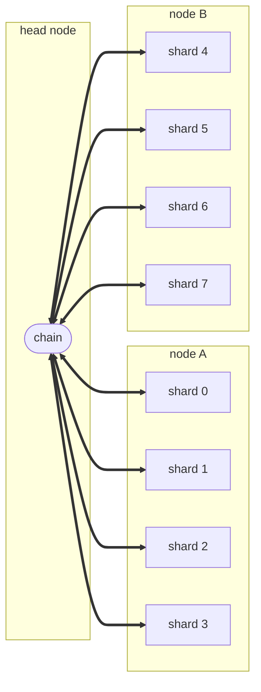
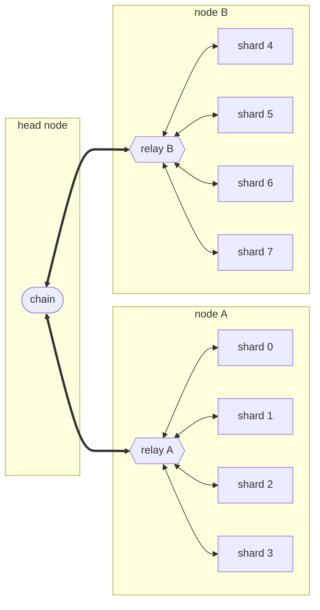
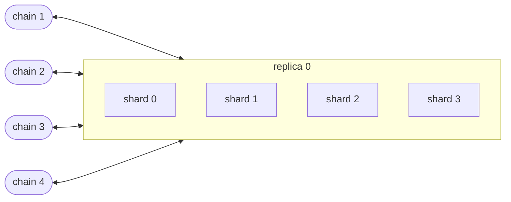
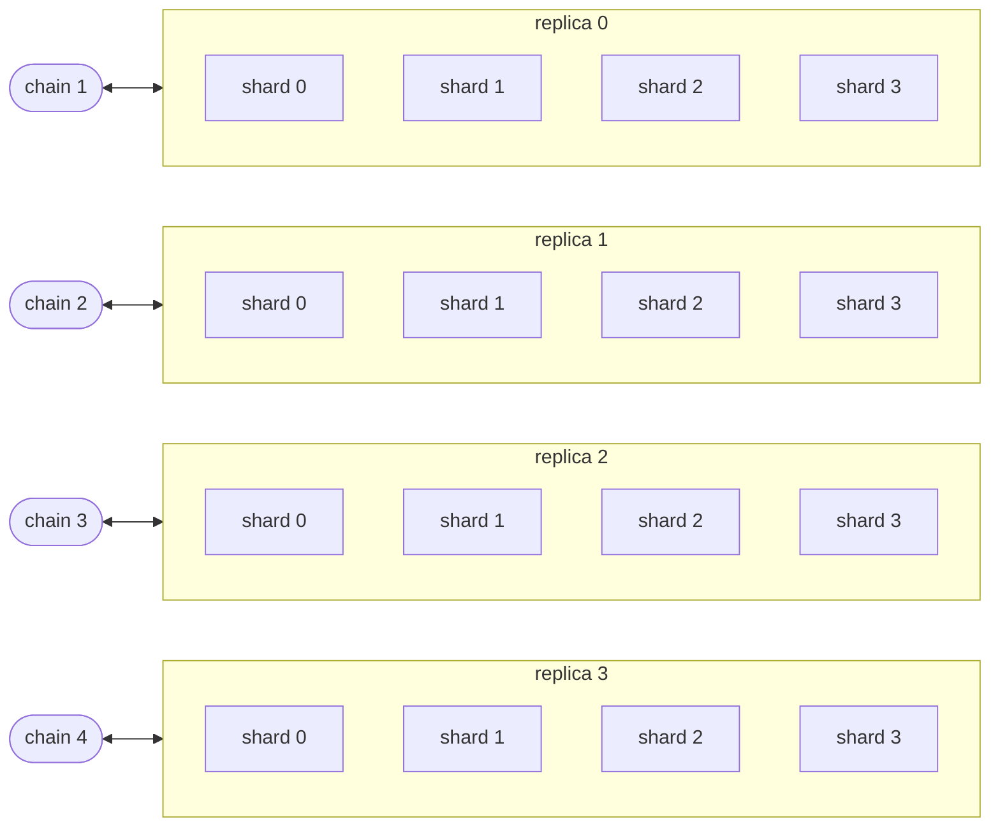

# Performance: when sharding pays off

How much `ShardedModel` helps depends on your model, your data and your hardware. On small data it is slower than plain PyMC, and on large data it can be several times faster. Measure on your own setup (see [Measuring on your own hardware](#measuring-on-your-own-hardware)). The model below explains what you will see.

## What a step costs

NUTS evaluates the log-density and its gradient once per leapfrog step, and multilevel posteriors often need tens to hundreds of steps per draw. With sharding, each step is
roughly

```
step time ≈ slowest shard's compute × (chains queued on each shard)
          + one round trip to the shards (latency + transfer of parameters and gradients)
          + a small overhead for every shard the chain contacts
```

Plain PyMC pays only the compute, all of it, on one core per chain. Sharding wins when splitting the compute saves more than the communication adds.

## Rules of thumb

- **Small data: stay in-process.** If one full-data evaluation is fast, the round trip to the actors costs more than it saves.

- **One large machine: sharding puts idle cores to work.** Each chain normally uses one core, shards let a chain use many. The gains level off once the shards saturate the machine's memory bandwidth, and they are smaller when several chains already keep several cores busy. Machines with many cores per chain benefit most.

- **Several machines: only on a low-latency network.** Every leapfrog step waits for a round trip to every machine that holds shards. Within a data center or rack that costs little. Between distant machines it can exceed the compute it saves, and then one large machine can be faster than several far-apart ones. To keep every shard on one node, pin the actors to it:

  ```python
  from ray.util.scheduling_strategies import NodeAffinitySchedulingStrategy

  here = NodeAffinitySchedulingStrategy(ray.get_runtime_context().get_node_id(), soft=False)
  sharded = pmr.ShardedModel(model_fn, data, n_shards=32, actor_options={"scheduling_strategy": here})
  ```

- **Many parameters: shard by group.** Every step sends the full parameter vector out and a gradient of the same size back. For multilevel models with thousands of groups, use `shard_by="<group column>"` so the gradients come back sparse.

- **More shards is not always faster.** Each shard a chain contacts adds per-step overhead, and past some point that outweighs the smaller shards. The sweet spot depends on the hardware, find it with `cluster_scaling.py` or `sharded.benchmark()`.

- **Fewer gradient evaluations mean fewer round trips.** A sampler that adapts well and a well-parameterized model help sharded sampling directly.

- **Memory is a reason on its own.** When PyMC's multiprocess sampler starts chains with `spawn` or `forkserver`, it copies the data into every chain process. `ShardedModel` keeps one copy, spread across the actors (one per replica), so it also helps when the data barely fit in memory.

## Options that change the communication

- **`shard_by=`** keeps each group's rows on one shard, so gradients come back as their nonzero entries only.

- **Relays** are on automatically when the shards span several nodes (`relays=` to override). Each chain sends one message per node per step. Each node's relay forwards it to its local shards and adds their gradients up before replying, so the traffic crossing the network no longer grows with the number of shards.

- **`n_replicas=`** makes that many copies of every shard actor. Each chain process (or thread) leases one replica and only ever talks to that replica's actors, so concurrent chains do not queue on the same actors. It helps when queueing or fan-out is the bottleneck and there is spare hardware. It costs `n_replicas` copies of the data in actor memory, and gains little when the hardware itself is already saturated.

- **`actor_options=`** passes Ray options to every shard actor. By default actors are spread across nodes (`scheduling_strategy="SPREAD"`); pin them to one node as shown above. `sharded.placement()` reports how many actors landed on each node.

- **`env_vars=`** sets two Ray settings in every process `ShardedModel` starts (shard actors, relays, PyMC's chain processes, and the sampling task through Ray Client). `RAY_get_check_signal_interval_milliseconds="10"` stops `ray.get` from sometimes waiting a full second for results that are already available, which on some clusters stalls most steps. `RAY_max_direct_call_object_size="8388608"` sends parameters and gradients of up to 8 MiB inside each call instead of through the object store, saving round trips between nodes on every step. Both are on by default and take precedence over the same variables in your job's `runtime_env`. Pass your own dict to replace them, or `env_vars={}` for Ray's defaults. They cannot reach a process that is already connected: when chains run in your own process without Ray Client (nutpie's threads, or `cores=1`), set them in its environment before `ray.init`.

### Example: relays

Two worker nodes hold four shards each, and one chain samples from the head node. The model has 10,000 parameters, so the parameter vector and each gradient are 80 KB. Each
arrow below is one round trip per leapfrog step, the parameters go out and a gradient comes back. Thick arrows cross the network and thin ones stay inside a node.

Without relays, the chain makes 8 round trips over the network every step (640 KB out, 640 KB back) and adds up 8 gradients itself.



With relays, it makes 2 round trips, one per node (160 KB each way). Each relay passes the parameters to the shards on its own node, adds up their gradients and replies once.



The shards compute the same thing and the result is identical, only the routing changes. Relays do not shorten the shards' compute. When the shards sit on the chain's own node there is no network to save and a relay only adds a hop, which is why relays are on by default only when the shards span several nodes. Pass `relays=True` if all the shards sit on one node that is not the chain's.

### Example: replicas

Four chains sample on one machine. One evaluation over all the data takes 80 ms on one CPU, and a shard actor serves one request at a time. An arrow into a replica below means the chain sends every step's request to each shard in it.

With 4 shards and 1 replica (4 CPUs), a request takes 20 ms, but all four chains send to the same four actors. Each actor works through the chains' requests one after another, so each chain gets a reply about every 80 ms.



With 4 shards and 4 replicas (16 CPUs), each chain leases its own copy of the four shards, round-robin. Nobody waits, and a step takes about 20 ms, at the cost of four copies of the data in memory:



The fair comparison spends the same 16 CPUs on more shards instead (layouts are SHARDSxREPLICAS):

| layout | CPUs | step (compute) | actors a chain contacts per step | copies of the data |
|---|---|---|---|---|
| `4x1` | 4 | ~80 ms | 4 | 1 |
| `4x4` | 16 | ~20 ms | 4 | 4 |
| `16x1` | 16 | ~20 ms (5 ms × 4 chains) | 16 | 1 |

On the same hardware the compute comes out the same, replicas only cut how many actors each chain contacts per step. They pay off when more shards stop helping because of that per-actor overhead (say `16x4` instead of `64x1` on 64 CPUs), and only if there is memory for the extra data copies.

## Measuring on your own hardware

Three scripts in [benchmarks/](https://github.com/Dekermanjian/pymc-ray/tree/main/benchmarks) answer the practical questions. All of them time one joint logp+gradient evaluation (one leapfrog step), and `--chains N` makes N
processes evaluate concurrently, as chains do while sampling. `ray_overhead.py` and `cluster_scaling.py` join a running cluster (`--address`, default `auto`) `gradient_eval.py` starts a local Ray instance on the machine it runs on.

1. **What does communication cost here?** `ray_overhead.py` times round trips to trivial actors, with no PyMC involved, from the driver to actors spread over all nodes, and from an actor to actors on its own node. A large jump as soon as actors span nodes means cross-node latency will dominate. Shard within one node in that case.

2. **Does sharding beat plain PyMC on one machine?** `gradient_eval.py` compares plain PyMC (`pmr.time_logp_dlogp(model, chains=4)`) with `ShardedModel` layouts written as SHARDSxREPLICAS, for a logistic or a multilevel model at the sizes you choose. To time your own model, call {func}`pmr.time_logp_dlogp(your_model, chains=4) <pymc_ray.time_logp_dlogp>` and `sharded.benchmark(chains=4)` directly.

3. **Does it beat plain PyMC on a cluster?** `cluster_scaling.py` runs plain PyMC as a Ray task pinned to one node, so both sides get the same hardware, then times each layout. It also reports the shards' own compute time per call. If a step takes much longer than (chains ÷ replicas) × that compute, the rest is communication. In that case try `--shard-by`, fewer shards, or `--single-node`.

Submit the cluster scripts as Ray jobs. The `pip` runtime environment installs PyMC into an isolated environment on every node, leaving the cluster's own Python untouched.

```bash
ray job submit --address http://<head-node>:8265 --working-dir benchmarks \
    --runtime-env-json '{"pip": ["pymc>=6.3", "narwhals>=2", "polars"], "py_modules": ["src/pymc_ray"]}' \
    -- python cluster_scaling.py --rows 5000000 --shard-by group
```

`--working-dir benchmarks` uploads only that folder, which also sidesteps a crash in older Ray versions on unusual `.gitignore` files elsewhere in the tree.

Useful flags:
`--groups`, `--layouts 16x1 32x1 8x4` (default `auto`, derived from the cluster's size), `--single-node`, `--relays {auto,on,off}`, and `--sample` for a short end-to-end `pm.sample` comparison. If the cluster autoscales, give it a fixed number of nodes before measuring because actors created while nodes are still starting all land on the first available node.
